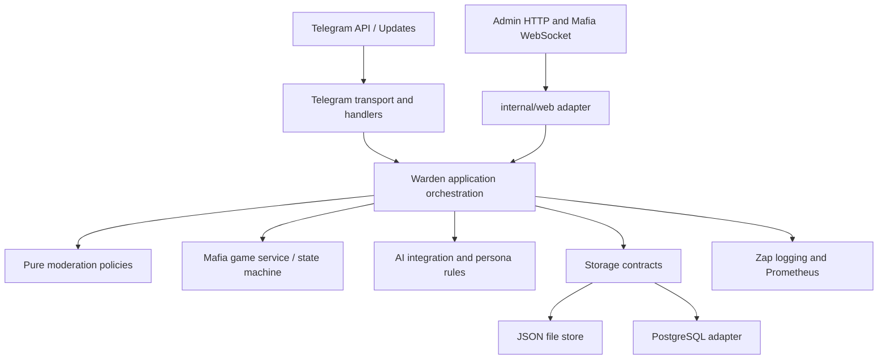

# Mirohodec Warden

[Русская версия README](README.ru.md)

**Production-history Telegram backend · Go 1.23 · PostgreSQL / JSON · AI character · Moderation · Mafia game · Admin panel**

A backend for a multi-community Telegram bot that combines configurable moderation, an AI-powered chat character **Laya**, and a stateful social deduction game. The original project was deployed to a VPS and used in a live community (reported by the author). This repository is a **public, sanitized backend showcase** of that project, not a claim of newly developed commercial deployments or production SLA.

> **Scope:** Backend source and the server-rendered admin panel are included. The separate React/Vite Mafia Mini App **client** is intentionally not bundled; its Go API, Telegram auth integration and WebSocket backend are preserved. No production configuration, user data, media or historical Git objects are included.

## What this project demonstrates

| Subsystem | Backend problem solved | Where to look |
| --- | --- | --- |
| Multi-chat moderation | Chat-specific policies, warning escalation, timed restrictions, permanent bans and protected accounts | `cmd/warden/handlers_warn_karma_*.go`, `internal/domain/moderation/` |
| Anti-spam | Sliding time windows, signature deduplication, multi-signal confidence, strike/cooldown policy | `cmd/warden/spam_runtime_*.go`, `internal/domain/antispam/` |
| Laya AI | OpenRouter-compatible HTTP integration, response context, quality filters, persona and safety rules | `cmd/warden/ai_service_*.go`, `handlers_ai_*.go`, `laya_*.go` |
| Stateful Mafia | Lobby lifecycle, roles, turns, voting, anti-leak rules, ELO, AI players, room state | `cmd/warden/mafia_service_*.go`, `mafia_store_*.go` |
| Persistence | File-backed JSON and PostgreSQL implementations, idempotent schema DDL, optional one-time import | `cmd/warden/repositories.go`, `postgres_store_*.go`, `migrations/` |
| Administration | Token-based sessions, web console, chat config, user management, Mafia HTTP/WS endpoints | `internal/web/` |
| Reliability and operations | Async structured logging, graceful shutdown, cleanup, config reload, Prometheus metrics | `cmd/warden/main.go`, `logging.go`, `metrics.go` |
| Testing | Unit tests for state transitions, integration edges and policy decisions | `*_test.go`, CI |

## Architecture at a glance



The original codebase contains a large application package in `cmd/warden`, with explicit runtime repositories and services. The public refactor extracts a **real, unit-tested domain policy**, decomposes long functions, and moves translation dictionaries and database DDL to data files. It **does not pretend that the entire legacy codebase is a fully isolated Clean Architecture**. See [Architecture and trade-offs](docs/ARCHITECTURE.md).

## Quick start

Requirements: **Go 1.23+**, a Telegram bot token, and (optionally) PostgreSQL + an OpenRouter-compatible key.

```bash
cp .env.example .env
cp config.example.yaml config.yaml
# Edit .env and set security.admin_ids in config.yaml
go mod download
go test ./...
go run ./cmd/warden -config config.yaml
```

By default: Telegram **long polling**, **JSON** local persistence, **AI disabled**, **admin web panel disabled**. No real bot token is provided. The bot needs Telegram admin permissions for deleting messages and restricting/ban actions; a forum topic is required for topic-based restriction.

**Docker** (uses the same JSON/default configuration):

```bash
cp .env.example .env
# Edit .env with a valid BOT_TOKEN
docker compose up --build -d
```

To enable the web panel, set `web.enabled: true`, configure a long `WEB_ADMIN_TOKEN` and publish port 8090 through a TLS-terminating reverse proxy. Do not expose `/metrics` or admin endpoints openly on the internet. For PostgreSQL, set `storage.driver: postgres`, configure `DATABASE_URL` and connect to your own DB. Use secure DB credentials; the example is for local development only.

## Representative scenarios

- **Moderation:** A member triggers three active warnings, the policy selects *mute*. After five warnings, the policy selects *topic restriction*, subject to the chat's configuration. The service checks existing moderation state before side effects.
- **Spam:** Text, stickers, links, mentions, forwards and repeats accumulate in separate time windows. Confidence, recent strikes and cooldowns determine whether to log, delete or mute.
- **Mafia:** A host creates a lobby, players register, roles are assigned privately, then the service moves through night actions, daytime discussion and voting. Illegal role leaks can cancel a game, with separate treatment of cancelled game statistics.
- **AI character:** A message mention/reply is converted into context for an external model; the bot applies configurable persona, response-quality and user-boundary rules. OpenRouter is an integration, not an in-repository model.
- **Admin panel:** The owner manages supergroups, warnings, chat settings and content from a server-rendered interface. Mafia Mini App endpoints validate Telegram init data, except in an explicitly enabled local development mode.

## Project layout

```text
cmd/warden/                Bot runtime, services, handlers, repositories
  migrations/              44 idempotent, ordered SQL statements
  locales/                 RU / EN translation dictionaries
internal/domain/             Telegram-independent policies and tests
internal/web/              HTTP handlers, panel templates, static assets, WS
scripts/check_public.py    Public-repository hygiene and 200-line Go checks
docs/                      Architecture, case study and security notes
.github/workflows/ci.yml   Style, tests, vet, build checks
```

**Code-style constraint:** Go source files are kept at **200 lines or fewer**. This is a navigation convention, not a substitute for modularity; splitting a file alone does not reduce package coupling. SQL migrations and translation dictionaries are data files and are not bound by this limit.

## Verification

```bash
python3 scripts/check_public.py
go test ./...
go vet ./...
go build ./cmd/warden
```

The public archive was statically parsed and the standalone moderation and anti-spam policy tests were run. Full end-to-end/build verification requires fetching the modules in `go.mod`, a Telegram token for live bot use and PostgreSQL for DB-specific integration tests. No uptime, load-test throughput, or user-count claims are made.

## Learn more

[Architecture](docs/ARCHITECTURE.md) · [Implementation case study](docs/CASE_STUDY.md) · [Security and publishing](docs/SECURITY.md)

**Author:** [AlphaZero-developer](https://github.com/AlphaZero-developer) · Original project: Mirohodec Warden · Backend language: Go.

[Publishing on GitHub](docs/PUBLISH.md)

**License:** No license is granted by default. Source is made available for portfolio review; contact the author for reuse or licensing.
